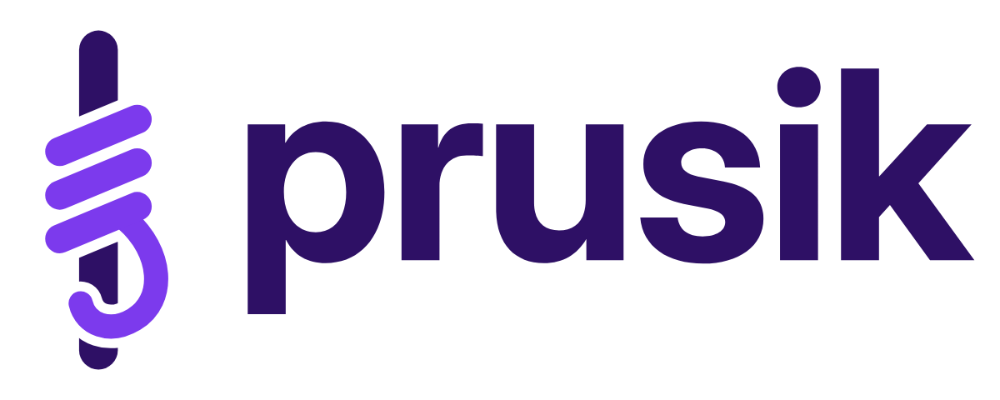
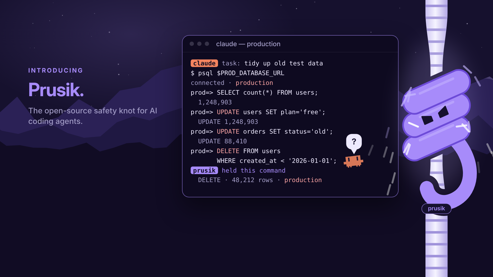
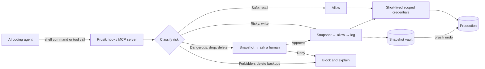

<div align="center">

<picture>
  <source media="(prefers-color-scheme: dark)" srcset="assets/prusik-logo-horizontal-dark.png">
  
</picture>

### Slides when you climb, grips when you fall.

**The open-source safety layer that lets AI coding agents work in production,<br>and catches every dangerous action with a snapshot, a human approval and an undo.**

[](LICENSE)
[](#roadmap)
[](#works-with)
[](#contributing)

[How it works](#how-it-works) · [Features](#features) · [Works with](#works-with) · [Policies](#policies) · [Roadmap](#roadmap) · [Contributing](#contributing)

</div>

<p align="center">
  
</p>

---

## Why Prusik?

AI coding agents now get the keys to real systems: the production database, the cloud account, the storage buckets. Most of the time that's fine. But once in a while an agent misreads a task and does something that can't be undone. In April 2026, an agent [deleted a company's database and its backups in 9 seconds](https://oecd.ai/en/incidents/2026-04-27-6153).

Prusik sits between the agent and production. Like the climbing knot it's named after, it **slides** freely while the agent works and **grips** the moment something dangerous happens.

- **Reads pass straight through.** No slowdown for normal work.
- **Writes are snapshotted first**, and the snapshot is stored where the agent can't reach it.
- **Destructive actions wait for a human "yes"** on your phone, with a plain-English explanation.
- **Anything can be undone** with `prusik undo`.

## How it works



**Example:** the agent decides to "clean up old test users" and runs `DELETE FROM users WHERE created_at < '2026-01-01'`.

1. The hook catches the command, and the SQL parser sees a `DELETE` on a production table.
2. A dry run estimates **48,212 rows**, including paying customers, so it's classified as **Dangerous**.
3. Prusik saves a snapshot and pings your phone: *"Claude Code wants to delete 48,212 users. Snapshot saved. Approve / Deny."*
4. You tap **Deny**. The agent is told why and narrows the query to `AND is_test = true` (212 rows), which runs automatically after a snapshot.
5. It's all in the audit log, and `prusik undo 7f3a` would restore those 212 rows.

## Features

| | Feature | What it does |
|---|---|---|
| 🧭 | **Risk classifier** | Deterministic parsers first (SQL syntax tree, cloud API actions). A small LLM only steps in for unclear cases and writes the explanation. It runs locally with Ollama or with any API key. |
| 📸 | **Automatic snapshots** | Neon / Supabase branching, `pg_dump` to S3, RDS snapshots and S3 versioning, all taken before any risky change. |
| 📱 | **Human approval** | CLI prompt, Telegram, Slack or ntfy push, with a one-line explanation of what will happen. |
| ↩️ | **One-command undo** | `prusik undo <id>` restores the snapshot. |
| 🔑 | **No real keys for agents** | A credential broker hands out short-lived, least-privilege credentials (AWS STS, scoped Postgres roles). |
| 📜 | **Policies as code** | Plain YAML rules, with community policy packs for Postgres, Supabase, AWS and Terraform. |
| 🧾 | **Audit log** | SQLite or JSONL with an OpenTelemetry export: *"what did the agent do last night?"* |
| ☁️ | **Scales to zero** | Runs on your laptop next to the agent, or as a serverless function that costs nothing when idle. |

**Safe by default:** backups are stored with credentials the agent never sees, deleting a backup is always forbidden, and Prusik fails *closed*. If something breaks, the action is blocked, not let through.

## Works with

| Agent | How Prusik plugs in |
|---|---|
| **Claude Code** | `PreToolUse` hook + plugin with the skill and MCP config |
| **Codex** | `PreToolUse` hook + MCP server |
| **Cursor** | Hook config + MCP server |
| **OpenCode** | Plugin `tool.execute.before` hook + MCP server, works with local models |
| **Any MCP agent** | Safe "front door" tools: `prusik.sql`, `prusik.aws` |

## Built with

<p>
  
</p>


## Quick start

> [!NOTE]
> Prusik is in early development. The commands below show the planned v0.1 interface.

```bash
# install the single binary (macOS, Linux, Windows)
go install github.com/OWNER/prusik@latest

# protect a Postgres database and connect your agent
prusik init --db "$PROD_DATABASE_URL"
prusik hook install claude-code     # or: codex, cursor, opencode

# day to day
prusik approve 7f3a                 # approve a held action from the CLI
prusik undo 7f3a                    # restore the snapshot taken before an action
prusik policy test policy.yaml      # check your rules against sample actions
```

## Policies

Rules are plain YAML, readable in a code review:

```yaml
# policy.yaml
environment: prod
rules:
  - match: { sql: [SELECT] }
    action: allow
  - match: { sql: [INSERT, UPDATE] }
    action: snapshot
  - match: { sql: [DELETE], rows_over: 100 }
    action: ask              # snapshot, then wait for a human
  - match: { sql: [DROP, TRUNCATE] }
    action: ask
  - match: { target: backups }
    action: forbid           # never, whoever asks
```

## Roadmap

- [ ] **v0.1 "It catches it":** Go CLI, Claude Code hook, SQL classifier, Neon / Supabase / `pg_dump` snapshots, CLI approval, `undo`
- [ ] **v0.2 "Phone in hand":** MCP server, Telegram / Slack approver on serverless, audit log
- [ ] **v0.3 "No keys for agents":** credential broker for Postgres and AWS STS
- [ ] **v0.4 "Measured":** SafeOps-Bench, an open eval suite and leaderboard of how well models and guards catch dangerous actions
- [ ] **v1.0:** Postgres wire proxy, GCP and Azure, policy-pack registry

## Contributing

Contributions are welcome, especially **policy packs** (new databases, clouds and IaC tools) and labeled examples for SafeOps-Bench. Look for issues tagged `good first issue`, and open a discussion before larger changes.

## Why "Prusik"?

A [Prusik](https://en.wikipedia.org/wiki/Prusik) is a climbing friction knot. It slides freely along the rope while you climb, and grips the instant you fall. Routine agent actions slide through untouched; the moment something dangerous happens, Prusik grips.

## License

[Apache-2.0](LICENSE). The Prusik name and logo are trademarks of the project.
